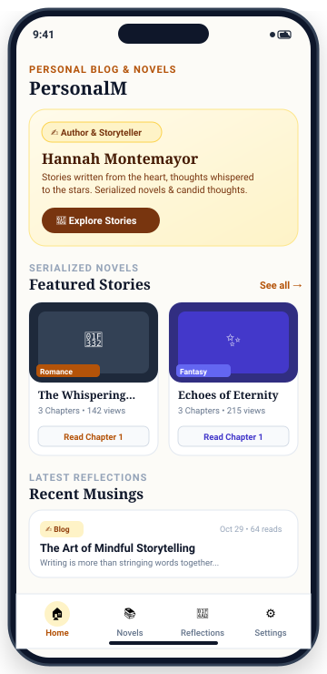
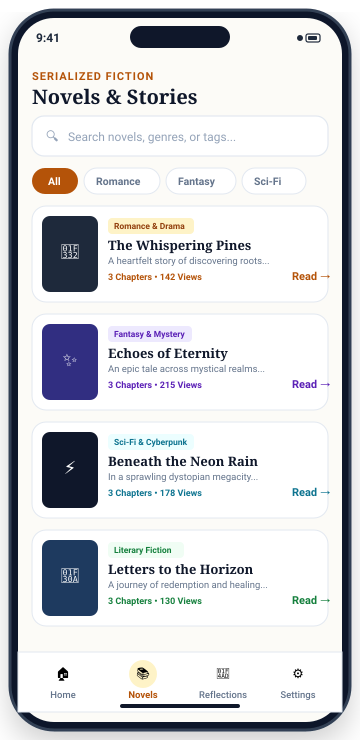
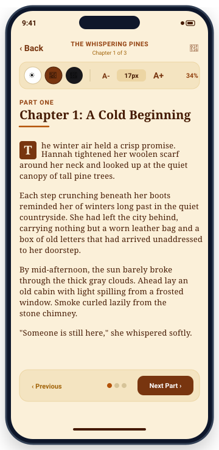
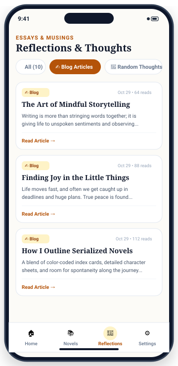

# PersonalM-blog-mobile

Official cross-platform mobile application (**iOS & Android**) for the **PersonalM Blog & Novel Platform**, crafted for author **Hannah Montemayor**.

Built with **React Native (0.76), Expo SDK 52, TypeScript, and React Navigation v6**.

---

## 📱 Sample UI Previews

### Visual Smartphone Mockups

| 1. Home Dashboard | 2. Novels Library |
| :---: | :---: |
|  |  |
| *Hero banner, author bio, featured novel carousel, and latest musings* | *Search bar, genre filters, chapter counters, and novel cards* |

| 3. Novel Chapter Reader | 4. Reflections & Musings |
| :---: | :---: |
|  |  |
| *Warm Sepia paper theme, A-/A+ font controls, and part navigation* | *Filterable stream: Blog essays & candid random thoughts* |

---

## 📐 Mobile Screen Wireframes & Anatomy

### Screen 1: Home Dashboard (`HomeScreen.tsx`)
```text
┌──────────────────────────────────────────────┐
│  9:41                                📶 🔋   │
│  PERSONAL BLOG & NOVELS                      │
│  PersonalM                                   │
├──────────────────────────────────────────────┤
│ ┌──────────────────────────────────────────┐ │
│ │ ✍️ Author & Storyteller                  │ │
│ │ Hannah Montemayor                        │ │
│ │ Stories written from the heart, thoughts │ │
│ │ whispered to the stars.                  │ │
│ │ [ 📖 Explore Stories ]                   │ │
│ └──────────────────────────────────────────┘ │
│                                              │
│  SERIALIZED NOVELS               See all →   │
│  Featured Stories                            │
│ ┌─────────────────┐  ┌─────────────────────┐ │
│ │ [🌲 Cover Art]  │  │ [✨ Cover Art]       │ │
│ │ The Whispering  │  │ Echoes of Eternity  │ │
│ │ 3 Ch. • 142 v.  │  │ 3 Ch. • 215 v.      │ │
│ │ [Read Ch. 1]    │  │ [Read Ch. 1]        │ │
│ └─────────────────┘  └─────────────────────┘ │
│                                              │
│  LATEST REFLECTIONS                          │
│ ┌──────────────────────────────────────────┐ │
│ │ ✍️ Blog                   Oct 29 • 64 r. │ │
│ │ The Art of Mindful Storytelling          │ │
│ │ Writing is more than stringing words...  │ │
│ └──────────────────────────────────────────┘ │
├──────────────────────────────────────────────┤
│  [🏠 Home]    [📚 Novels]   [💭 Blog]  [⚙️]  │
│                      —                       │
└──────────────────────────────────────────────┘
```

---

### Screen 2: Serialized Novels Library (`StoriesScreen.tsx`)
```text
┌──────────────────────────────────────────────┐
│  9:41                                📶 🔋   │
│  SERIALIZED FICTION                          │
│  Novels & Stories                            │
├──────────────────────────────────────────────┤
│ ┌──────────────────────────────────────────┐ │
│ │ 🔍 Search novels, genres, or tags...     │ │
│ └──────────────────────────────────────────┘ │
│  (All)   [Romance]   [Fantasy]   [Sci-Fi]    │
│                                              │
│ ┌──────────────────────────────────────────┐ │
│ │ ┌────────┐ Romance & Drama               │ │
│ │ │🌲Cover │ The Whispering Pines          │ │
│ │ │  Art   │ A heartfelt story of roots... │ │
│ │ └────────┘ 3 Chapters • 142 Views [Read→]│ │
│ └──────────────────────────────────────────┘ │
│ ┌──────────────────────────────────────────┐ │
│ │ ┌────────┐ Fantasy & Mystery             │ │
│ │ │✨Cover │ Echoes of Eternity            │ │
│ │ │  Art   │ An epic tale of hidden realms │ │
│ │ └────────┘ 3 Chapters • 215 Views [Read→]│ │
│ └──────────────────────────────────────────┘ │
│ ┌──────────────────────────────────────────┐ │
│ │ ┌────────┐ Sci-Fi & Cyberpunk            │ │
│ │ │⚡Cover │ Beneath the Neon Rain         │ │
│ │ │  Art   │ Sprawling dystopian city...   │ │
│ │ └────────┘ 3 Chapters • 178 Views [Read→]│ │
│ └──────────────────────────────────────────┘ │
├──────────────────────────────────────────────┤
│  [🏠 Home]   (📚 Novels)    [💭 Blog]  [⚙️]  │
│                      —                       │
└──────────────────────────────────────────────┘
```

---

### Screen 3: Novel Chapter Reader (`ReaderScreen.tsx`)
```text
┌──────────────────────────────────────────────┐
│  9:41                                📶 🔋   │
│  ‹ Back       THE WHISPERING PINES       🔖  │
│                  Chapter 1 of 3              │
├──────────────────────────────────────────────┤
│ ┌──────────────────────────────────────────┐ │
│ │ [☀️ Light]  (📜 Sepia)  [🌙 Dark]        │ │
│ │  A-  [ 17px ]  A+                   34%  │ │
│ └──────────────────────────────────────────┘ │
│                                              │
│  PART ONE                                    │
│  Chapter 1: A Cold Beginning                 │
│  ─────────────────────────                   │
│                                              │
│  [T] he winter air held a crisp promise.     │
│  Hannah tightened her woolen scarf around    │
│  her neck and looked up at the quiet         │
│  canopy of tall pine trees.                  │
│                                              │
│  Each step crunching beneath her boots       │
│  reminded her of winters long past in the    │
│  countryside. She had left the city behind,  │
│  carrying nothing but a worn leather bag     │
│  and a box of old unaddressed letters...     │
│                                              │
│ ┌──────────────────────────────────────────┐ │
│ │ ‹ Previous Part      ● ○ ○   [Next Part ›│ │
│ └──────────────────────────────────────────┘ │
├──────────────────────────────────────────────┤
│                      —                       │
└──────────────────────────────────────────────┘
```

---

### Screen 4: Reflections & Musings Feed (`BlogScreen.tsx`)
```text
┌──────────────────────────────────────────────┐
│  9:41                                📶 🔋   │
│  ESSAYS & MUSINGS                            │
│  Reflections & Thoughts                      │
├──────────────────────────────────────────────┤
│  [All (10)]   (✍️ Blog Articles)   [💭 Random]│
│                                              │
│ ┌──────────────────────────────────────────┐ │
│ │ ✍️ Blog                   Oct 29 • 64 r. │ │
│ │ The Art of Mindful Storytelling          │ │
│ │ Writing is more than stringing words     │ │
│ │ together; it is giving life to unspoken  │ │
│ │ sentiments and quiet observation...      │ │
│ │ Read Article →                           │ │
│ └──────────────────────────────────────────┘ │
│ ┌──────────────────────────────────────────┐ │
│ │ ✍️ Blog                   Oct 29 • 88 r. │ │
│ │ Finding Joy in the Little Things         │ │
│ │ Life moves fast, and often we get        │ │
│ │ caught up in deadlines and huge plans... │ │
│ │ Read Article →                           │ │
│ └──────────────────────────────────────────┘ │
├──────────────────────────────────────────────┤
│  [🏠 Home]    [📚 Novels]   (💭 Blog)  [⚙️]  │
│                      —                       │
└──────────────────────────────────────────────┘
```

---

## 🏗️ System Architecture

```mermaid
flowchart TD
    API["PersonalM-blog-api\n(Express + PostgreSQL)\nhttp://localhost:5000"]

    subgraph MobileApp ["PersonalM-blog-mobile"]
        Nav["React Navigation (Bottom Tabs + Native Stack)"]
        HomeView["HomeScreen\n(Hero, Featured Stories, Bio)"]
        StoriesView["StoriesScreen\n(Search, Filters, Novel Cards)"]
        DetailView["StoryDetailScreen\n(Table of Contents, Synopsis)"]
        ReaderView["ReaderScreen\n(Light/Sepia/Dark Themes, Font A-/A+)"]
        BlogView["BlogScreen\n(Blog & Random Thoughts)"]
        SettingsView["SettingsScreen\n(Dynamic API URL, Offline Sync)"]
        ApiService["api.ts Service\n(Network Fetch + Fallback Data)"]
    end

    Nav --> HomeView
    Nav --> StoriesView
    Nav --> BlogView
    Nav --> SettingsView
    StoriesView --> DetailView
    DetailView --> ReaderView
    HomeView --> ReaderView

    HomeView --> ApiService
    StoriesView --> ApiService
    DetailView --> ApiService
    ReaderView --> ApiService
    BlogView --> ApiService

    ApiService -->|REST API (JSON)| API
```

---

## ✨ Features Breakdown

- **📖 Serialized Novels Catalog**: Browse novel collections with genres, cover art, tags, chapter count, and total view counts.
- **👓 Immersive Novel Chapter Reader**:
  - **Font Size Scaling**: Tap `A-` or `A+` to dynamically scale font from `14px` up to `24px`.
  - **Reading Themes**:
    - **Clean Light**: Crisp white backdrop (`#ffffff`) for bright daylight reading.
    - **Warm Sepia (Paper)**: Gentle eye-friendly cream parchment (`#fbf0d9`) matching physical books.
    - **Midnight Dark**: Battery-saving OLED dark canvas (`#18181b`) for late-night reading.
  - **Navigation**: Previous Part / Next Part buttons with reading progress indicators.
- **✍️ Blog & Candid Musings**: Filterable feed with real-time category switching (`All`, `Blog Articles`, `Random Thoughts`).
- **🛡️ Offline Resilience**: Built-in offline fallback store guaranteeing the app stays fully readable even without an active internet connection.
- **⚙️ Dynamic Backend Switcher**: Change the API URL directly inside the Settings tab (e.g. switch between `http://10.0.2.2:5000` for Android Emulator, your local LAN IP for physical device testing, or a cloud production server).

---

## 🛠️ Getting Started

### 1. Prerequisites
- **Node.js**: v18+ (tested on Node.js 24)
- **Expo Go App**: Install **Expo Go** from the [Apple App Store](https://apps.apple.com/app/expo-go/id982107779) (iOS) or [Google Play Store](https://play.google.com/store/apps/details?id=host.exp.exponent) (Android).

### 2. Install Dependencies
```bash
cd D:\PersonalM-blog-mobile
npm install
```

### 3. Start Expo Dev Server
```bash
npx expo start
```

- **Physical Device**: Open the Camera app (iOS) or Expo Go app (Android) and scan the QR code displayed in the terminal.
- **Android Emulator**: Press `a` in the terminal.
- **iOS Simulator**: Press `i` in the terminal (macOS required).

---

## 🚀 Building Standalone Apps (APK & IPA)

To build standalone binary installers for Google Play Store and Apple App Store, use **EAS Build**:

1. Install EAS CLI:
   ```bash
   npm install -g eas-cli
   eas login
   ```
2. Configure project:
   ```bash
   eas build:configure
   ```
3. Build for Android APK (for direct sideload testing):
   ```bash
   eas build -p android --profile preview
   ```
4. Build for Production (Google Play AAB / Apple App Store IPA):
   ```bash
   eas build -p android --profile production
   eas build -p ios --profile production
   ```

---

## 📄 License
This project is open-source under the [MIT License](LICENSE).
