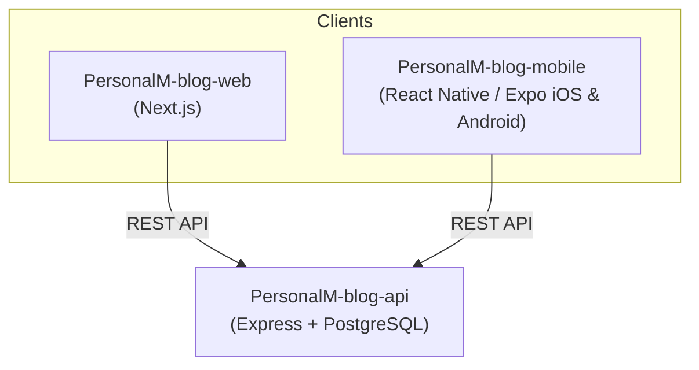

# PersonalM-blog-mobile

Official cross-platform mobile application (**iOS & Android**) for the **PersonalM Blog & Novel Platform**, designed for author **Hannah Montemayor**.

Built with **React Native, Expo SDK 52, and TypeScript**.

---

## 🏗️ Architecture



---

## ✨ Features

- **Serialized Novels Library**: Discover fiction, novel collections, genre tags, and chapter counts.
- **Novel Chapter Reader**:
  - **Font Size Scaling**: Adjustable text sizing (A- / A+) for comfortable reading.
  - **Reading Themes**: Switch between **Clean Light**, **Warm Sepia (Paper)**, and **Midnight Dark**.
  - **Chapter Navigation**: Seamless Previous Part / Next Part transitions.
- **Blog & Random Thoughts**: Editorial articles and short musings with category filters.
- **Offline Resilience**: Built-in fallback catalog ensuring the app stays functional even with intermittent mobile connectivity.
- **Configurable API Endpoint**: Change backend URL dynamically inside the Settings tab for local Wi-Fi or production environments.

---

## 📱 Screenshots & Screens

1. **Home**: Hero banner, author bio, featured novel carousel, and latest reflections.
2. **Novels**: Full serialized novel library with real-time title and genre search.
3. **Novel Detail**: Cover art, synopsis, metadata, and chapters table of contents.
4. **Reader**: Dedicated reading layout with typography controls and theme options.
5. **Blog & Musings**: Filterable feed (`All`, `Blog Articles`, `Random Thoughts`).
6. **Settings**: Central API configuration, offline status, and app information.

---

## 🛠️ Getting Started

### 1. Prerequisites
- **Node.js**: v18+ (tested on Node.js 24)
- **Expo Go App**: Install **Expo Go** from the [Apple App Store](https://apps.apple.com/app/expo-go/id982107779) (iOS) or [Google Play Store](https://play.google.com/store/apps/details?id=host.exp.exponent) (Android) on your physical mobile device.

### 2. Clone & Install Dependencies
```bash
git clone https://github.com/paulrndp/PersonalM-blog-mobile.git
cd PersonalM-blog-mobile
npm install
```

### 3. Run Development Server
```bash
npx expo start
```

- **Physical Device**: Scan the generated QR code using the Camera app (iOS) or Expo Go app (Android).
- **Android Emulator**: Press `a` in the terminal.
- **iOS Simulator**: Press `i` in the terminal (macOS required).

---

## 🚀 Building Standalone Apps (APK & IPA)

To build standalone binary installers for Google Play Store and Apple App Store, use **EAS Build**:

1. Install EAS CLI:
   ```bash
   npm install -g eas-cli
   eas login
   ```
2. Configure project:
   ```bash
   eas build:configure
   ```
3. Build for Android APK (for direct testing):
   ```bash
   eas build -p android --profile preview
   ```
4. Build for Production (AAB / IPA):
   ```bash
   eas build -p android --profile production
   eas build -p ios --profile production
   ```

---

## 📄 License
This project is open-source under the [MIT License](LICENSE).
